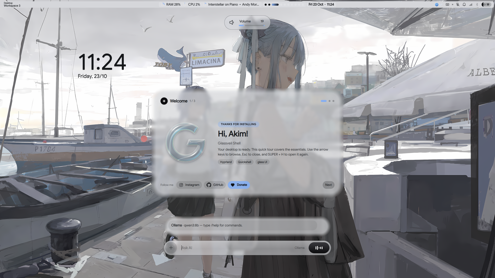

<p align="center">
  
</p>

<p align="center">
  
</p>

<h1 align="center">Glassveil Shell</h1>

<p align="center">
  A minimal Hyprland desktop environment, built with Quickshell.
</p>

<p align="center">
  <code>Arch Linux</code> · <code>Hyprland</code> · <code>Quickshell</code>
</p>

<p align="center">
  <a href="https://github.com/akimsupernova"></a>
  <a href="https://instagram.com/akimpng"></a>
</p>

<p align="center">
  <a href="https://patreon.com/powdurst"></a>
  <a href="https://ko-fi.com/akimpng"></a>
</p>

---

## Contents

- [Overview](#overview)
- [Key Capabilities](#key-capabilities)
- [Requirements](#requirements)
- [Installation](#installation)
- [Optional: Hardware Driver Installer](#optional-hardware-driver-installer)
- [Key Bindings](#key-bindings)
- [Settings Panel](#settings-panel)
- [AI Panel](#ai-panel)
- [Theming](#theming)
- [Wallpaper](#wallpaper)
- [Brightness and Volume](#brightness-and-volume)
- [Clock and Weather](#clock-and-weather)
- [Notepad](#notepad)
- [Repository Layout](#repository-layout)
- [Troubleshooting](#troubleshooting)
- [Uninstallation](#uninstallation)
- [License](#license)

## Overview

Glassveil Shell is a preconfigured desktop environment for Arch Linux.

- **Hyprland** provides window management.
- **Quickshell** provides the bar, panels and menus.

Deployment requires a single command. Day-to-day configuration is handled through the **Settings panel**, so manual file editing is not required.

## Key Capabilities

- **Bar, launcher, sidebar, power menu and lock screen.** The sidebar consolidates notifications, Wi-Fi, Bluetooth, a calendar and a Pomodoro timer.
- **Settings panel** (`SUPER + B`). Configure appearance, bar, clock, weather, wallpaper, monitors, audio, the AI panel, notifications, the lock screen and night light. Changes take effect immediately and are retained.
- **AI panel** (`SUPER + A`). Connect to OpenAI, Claude, Gemini, a local Ollama instance and other providers. File attachments are supported, as is image generation through Ollama.
- **Wallpaper-driven color scheme.** The accent color is derived from the active wallpaper and applied consistently across the shell, kitty, fish, GTK applications, Qt applications and Kvantum. A light or dark mode may also be selected.
- **Image and video wallpapers.**
- **Safe installer.** Existing configurations are backed up and can be restored on request.

## Requirements

### Software

- Arch Linux or a compatible distribution (CachyOS is supported).
- A standard user account with `sudo` privileges. The installer must not be run as root.

The installer may be run from a TTY on a fresh Arch Linux installation. Upon completion, reboot and start Hyprland from the TTY or from a display manager (see [Installation](#installation)).

### Hardware

| | Minimum | Recommended |
| --- | --- | --- |
| RAM | 4 GB | 8 GB or more |
| Graphics | Intel UHD (integrated) | Dedicated GPU (AMD or NVIDIA) |

The shell operates on the minimum configuration; however, graphically intensive effects such as blur and video wallpapers may reduce responsiveness. Running local AI models through Ollama requires additional RAM and a capable GPU.

## Installation

```bash
git clone --depth 1 https://github.com/akimsupernova/dots
cd dots
./setup install
```

If no display manager is present, install one or start Hyprland directly from the TTY.

<details>
<summary><b>Display manager and installer options</b></summary>

Install and enable SDDM:

```bash
sudo pacman -S sddm && sudo systemctl enable sddm
```

Installer options:

```bash
./setup install             # packages + dotfiles
./setup install --no-deps   # dotfiles only; skip packages
./setup install -n          # dry run: preview all actions without making changes
./setup install -y          # confirm all prompts automatically
./setup install --reboot    # reboot upon completion
./setup deps                # install yay and packages only
./setup specs               # regenerate the PC specifications file for the AI panel
./setup uninstall           # remove the dotfiles and restore the previous backup
./setup help
```

</details>

## Optional: Hardware Driver Installer

Glassveil Shell includes an optional utility, [`driver`](driver), that identifies the hardware of your PC or laptop and provisions the corresponding drivers and system services. Use of this utility is entirely at your discretion. The desktop installer (`./setup install`) does not invoke it, and the shell does not depend on it.

It is recommended in the following situations:

- A fresh installation in which graphics, Wi-Fi, Bluetooth or audio devices are not yet functioning correctly.
- A laptop with hybrid graphics (integrated GPU combined with an NVIDIA GPU).
- A system with a proprietary-driver requirement, such as an NVIDIA GPU or a Broadcom Wi-Fi adapter.

```bash
./driver install
```

<details>
<summary><b>Driver commands, scope and operating notes</b></summary>

Commands:

```bash
./driver detect             # report detected hardware and planned packages; no changes are made
./driver install -n         # dry run: preview every step without modifying the system
./driver install            # install and configure the drivers
./driver install -y         # confirm all prompts automatically
./driver install --no-aur   # restrict installation to the official repositories
./driver help
```

Scope:

| Area | Action |
| --- | --- |
| NVIDIA GPU | Selects the driver branch according to GPU generation: `nvidia-open-dkms` for Turing (GTX 16xx / RTX 20xx) and newer; the `nvidia-580xx-dkms` legacy branch from the AUR for Maxwell, Pascal and Volta; and the open-source nouveau driver for older cards. Configures kernel mode setting and suspend/resume support. |
| AMD / Intel GPU | Installs the Mesa, Vulkan and VA-API (hardware video acceleration) packages appropriate to the GPU generation. |
| Hybrid graphics | Adds PRIME tooling. An application can be run on the NVIDIA GPU with `prime-run <application>`. |
| CPU | Installs `intel-ucode` or `amd-ucode` and regenerates the GRUB configuration where GRUB is in use. |
| Firmware and audio | Installs `linux-firmware`, the PipeWire stack and, where applicable, `sof-firmware`. |
| Wi-Fi and Bluetooth | Installs the regulatory database, the Broadcom `wl` driver for chipsets that require it, and the Bluetooth stack with its service. |
| Laptops | Installs `power-profiles-daemon` and, on Intel systems, `thermald`. |
| Other devices | Fingerprint readers (`fprintd`), USB printers (CUPS), Thunderbolt (`bolt`) and guest tools for virtual machines (QEMU/KVM, VirtualBox, VMware, Hyper-V). |

Operating notes:

- Run the utility as a standard user, not as root. `sudo` is requested where required. The utility may be run repeatedly; installed packages are skipped.
- A reboot is required for new kernel modules to take effect.
- 32-bit graphics libraries (`lib32-*`, relevant for Steam) are installed only when the `[multilib]` repository is enabled in `/etc/pacman.conf`. The utility does not modify that file.
- On a system with a single NVIDIA GPU, the utility creates `~/.config/hypr/custom/gpu.lua` containing the recommended environment variables and loads it from `hyprland.lua`. Re-running `./setup install` replaces `~/.config/hypr`; run `./driver install` again afterwards to restore this file.
- Fingerprint login through PAM is not configured automatically. Enroll a fingerprint with `fprintd-enroll`.
- Out-of-tree drivers for certain USB Wi-Fi adapters (for example, some Realtek models) are not installed automatically. The utility reports when such a device is detected.
- `./setup uninstall` removes the dotfiles only. Drivers installed by `./driver` remain on the system and can be removed with `pacman -Rns`.

</details>

## Key Bindings

`SUPER` denotes the Windows key. Press `SUPER + /` to display a live reference of all key bindings.

### Optional: Steam

Steam requires the `[multilib]` repository. Remove the `#` from the `[multilib]` section and the `Include` line beneath it in `/etc/pacman.conf`, then install Steam.

<details>
<summary><b>Steam installation</b></summary>

```bash
sudo pacman -Syu steam
```

</details>

## Settings Panel

Open the panel with `SUPER + B`, or select the gear icon at the top of the sidebar (`SUPER + N`).

Every change is applied immediately and stored in `~/.config/glassveil/settings.json`. To restore all defaults, select **Reset** in the About tab.

### Glassveil Style

This setting governs the shell **and** your applications (kitty, fish, GTK applications and Qt applications).

- **Auto** follows the wallpaper. A light wallpaper results in a light theme.
- **Light** or **Dark** remains fixed regardless of the wallpaper.

Applications that are already open may need to be restarted to reflect the new colors.

### Window Gaps and Corners

The three sliders under **App windows** modify Hyprland directly. Until a slider is adjusted, your Hyprland configuration remains untouched. The values are reapplied after each login and each Hyprland reload. Select **Use config** to revert to the values defined in your configuration files.

### Monitor Settings

Located at the end of the Wallpaper tab. Select a monitor on the layout map and drag it to reposition it. Resolution, refresh rate, rotation, scale and position are configurable.

After you select **Apply**, you have 10 seconds to confirm with **Keep**. If no action is taken, the previous settings are restored automatically, which prevents loss of the display. Saved settings are written to `~/.config/hypr/modules/monitors.lua`.

The same settings are also available through `SUPER + M`.

### Night Light

Applies a warmer color temperature to reduce eye strain in the evening. Warmth level and an optional schedule are configurable. It requires `hyprsunset`, which the installer provides. The screen may flicker briefly when the warmth level is changed.

### Lock Screen

- **Lock when idle** offers three modes: *Battery only*, *Always* or *Never*.
- Select the number of idle minutes before the screen locks.
- **Keep awake** in the sidebar suspends automatic locking.
- `SUPER + L` locks the screen immediately.

## AI Panel

The panel supports **OpenAI, Claude, Gemini, OpenRouter, Groq, DeepSeek, Mistral, xAI** and **Ollama**.

### Getting Started

1. Press `SUPER + A`.
2. Enter `/apikey openai sk-...` (or `claude`, `gemini`, and so on) and press Enter.
3. Submit your first request.

For Ollama, install it first, pull a model (for example, `ollama pull llama3.2`), and then enter `/provider ollama`.

Appearance and behavior (size, position, chat theme, response style and custom instructions) can be adjusted under **Settings → AI**.

<details>
<summary><b>AI panel commands</b></summary>

| Command | Function |
| --- | --- |
| `/apikey` | Display saved keys (masked except for the final characters) |
| `/apikey <provider> <key>` | Save a key and switch to that provider |
| `/apikey remove <provider>` | Delete a saved key |
| `/provider <name>` | Switch provider (or select the provider name in the input bar) |
| `/model <name>` | Change the model (`/model default` restores the default) |
| `/endpoint <provider> <url>` | Use an alternative address (OpenAI-compatible, or your own Ollama server) |
| `/attach <path>` | Attach a file (see [Attaching Files](#attaching-files)) |
| `/attach clipboard` | Attach the file or image currently on the clipboard |
| `/detach` | Remove all attached files |
| `/image <text>` | Generate an image with an Ollama image model (see [Image Generation](#image-generation)) |
| `/imagemodel <name>` | Select the model used by `/image` (`/imagemodel default` clears the selection) |
| `/web on\|off` | Allow the AI to search the internet (see [Web Search](#web-search)) |
| `/web backend <name>` | Select the search service: `ddg`, `searxng` or `ollama` |
| `/web url <url>` / `/web key <key>` | Set the SearXNG address or the Ollama search key |
| `/ctx <tokens>` | Ollama context size per chat (default 16384) |
| `/clear` (or `/new`) | Start a new chat (the previous chat is saved) |
| `/history` · `/load <n>` | List saved chats and open one |
| `/maxtokens <n\|auto>` | Maximum response length to request |
| `/think on\|off\|low\|medium\|high` | Reasoning level for Ollama models |
| `/help` | Display the command list |

Aliases: `chatgpt` (or `gpt`) = openai, `claude` = anthropic, `google` = gemini, `grok` = xai, `local` = ollama, `or` = openrouter. `/search` is equivalent to `/web`, `/use` to `/provider`, and `/imagine` to `/image`.

The **+** button opens a menu with equivalent actions: new chat, copy the last reply, provider, web search, attach file, generate image (Ollama only), model, API key and help.

</details>

### Attaching Files

Files can be attached in four ways:

- Copy a file in your file manager (`Ctrl + C`), then press `Ctrl + V` in the AI input bar, or select **Attach from clipboard** in the **+** menu. A copied image or screenshot is attached in the same way. If the clipboard contains only text, `Ctrl + V` pastes it as usual.
- Select **Attach file…** from the **+** menu to open the built-in file picker. It is displayed inside the panel, so no separate file manager application is needed.
- Drag a file from your file manager onto the panel.
- Enter `/attach ~/notes.txt`.

The file appears as a small tag above the input bar. Select the **x** to remove it. It is sent with your next message. If no message is entered, the AI describes or summarizes the file.

| File type | Handling | Supported by |
| --- | --- | --- |
| Text, code, logs, Markdown, JSON, CSV | The text is appended to your message (very long files are truncated) | All providers |
| PDF | The text is extracted and appended to your message | All providers |
| Images (PNG, JPEG; WebP, GIF and BMP with `python-pillow`) | The image is sent to the model | Ollama models with image support |

Considerations:

- The model must support image input. Suitable options include `qwen3.5`, `gemma3`, `llama3.2-vision` and `qwen2.5vl`. If the model does not support images, the panel notifies you and does not send the image.
- Clipboard attachment requires `wl-clipboard` (provided by the installer).
- The built-in file picker offers shortcuts to Home, Downloads, Documents and Pictures, a name filter, an option to show hidden files and thumbnails for images. Select a file to attach it, or hold `Ctrl` while selecting to attach several files in succession. Press `Esc` to close it.
- PDF extraction requires `poppler` (provided by the installer). Scanned PDFs contain no extractable text.
- Attached text remains in the chat, so follow-up questions about it can be asked later.

### Image Generation

Ollama can run image models. This capability is new and remains experimental in Ollama.

<details>
<summary><b>Image generation commands</b></summary>

```text
ollama pull x/z-image-turbo
/imagemodel x/z-image-turbo
/image a lighthouse in a storm, oil painting
```

</details>

- If the chat model is itself an image model, every message you send generates an image, and `/imagemodel` is not required.
- The image is displayed in the chat. Select it to open it. A copy is saved to `~/Pictures/Glassveil/`.
- The first image may take longer because the model must be loaded.
- Models that only interpret images, such as Qwen 3.5, cannot generate them. Use a dedicated image model with `/image`.

### Web Search

Enable it through **Web search** in the **+** menu, or enter `/web on`.

- **Ollama:** the model determines when to search or open a page. A model with tool support is required. If tool support is unavailable, the model answers without searching and displays a brief notice.
- **Other providers:** every message is searched first. The top results are added to your question, and the sources are shown beneath the reply.

<details>
<summary><b>Search service configuration</b></summary>

```text
/web backend ddg                no key required; reads DuckDuckGo (default)
/web backend searxng            your own SearXNG server
/web url https://search.example.org
/web backend ollama             Ollama web search (free account key)
/web key <key>                  key from https://ollama.com/settings/keys
```

</details>

Considerations:

- `ddg` reads a DuckDuckGo page and may therefore be slow or intermittently unavailable. `searxng` and `ollama` are more stable.
- Your search queries leave your computer, even when the model runs locally.
- Pages on your own computer or network (localhost, `192.168.x.x`, `10.x.x.x` and similar) are blocked, which prevents a web page from manipulating the model into reaching them.

<details>
<summary><b>SearXNG setup (optional)</b></summary>

Install the build tools first:

```bash
sudo pacman -S --needed git base-devel python libxslt libxml2 zlib
```

Then obtain the source and create a Python virtual environment:

```bash
git clone --depth 1 https://github.com/searxng/searxng ~/.local/share/searxng
cd ~/.local/share/searxng
python -m venv venv
./venv/bin/pip install -U pip setuptools wheel pyyaml msgspec typing_extensions
./venv/bin/pip install --use-pep517 --no-build-isolation -e .
```

Create the settings file:

```bash
mkdir -p ~/.config/searxng
cat > ~/.config/searxng/settings.yml <<EOF
use_default_settings: true
server:
  bind_address: "127.0.0.1"
  port: 8888
  secret_key: "$(openssl rand -hex 32)"
  limiter: false
search:
  formats:
    - html
    - json
EOF
```

Test the service:

```bash
SEARXNG_SETTINGS_PATH=~/.config/searxng/settings.yml \
  ~/.local/share/searxng/venv/bin/python -m searx.webapp
```

Verify operation from a second terminal. A `403` response indicates that `json` is missing from `formats`.

```bash
curl "http://127.0.0.1:8888/search?q=test&format=json" | head -c 300
```

To start the service automatically at login, add a user service. Stop the test run with `Ctrl + C` first.

```bash
mkdir -p ~/.config/systemd/user
cat > ~/.config/systemd/user/searxng.service <<'EOF'
[Unit]
Description=SearXNG
After=network-online.target

[Service]
WorkingDirectory=%h/.local/share/searxng
Environment=SEARXNG_SETTINGS_PATH=%h/.config/searxng/settings.yml
ExecStart=%h/.local/share/searxng/venv/bin/python -m searx.webapp
Restart=on-failure

[Install]
WantedBy=default.target
EOF

systemctl --user daemon-reload
systemctl --user enable --now searxng
```

Then, in the AI panel:

```text
/web url http://127.0.0.1:8888
/web backend searxng
/web on
```

Notes:

- `bind_address: "127.0.0.1"` restricts access to your own computer. Do not expose the service to the network.
- Some search engines (Google in particular) may be temporarily blocked. Results continue to be returned by the remaining engines.
- To review errors: `journalctl --user -u searxng -f`.
- To update:

  ```bash
  cd ~/.local/share/searxng
  git pull
  ./venv/bin/pip install --use-pep517 --no-build-isolation -e .
  systemctl --user restart searxng
  ```

</details>

### Privacy

- API keys and AI settings are stored **encrypted** (AES-256-GCM) in `~/.config/glassveil/ai.json`. The encryption key is held in the system keyring (Secret Service, for example GNOME Keyring or KeePassXC) when one is running. Otherwise it is stored in `~/.local/share/glassveil/vault.key` (mode 600), a different directory from the configuration, so that synchronizing or committing `~/.config` does not expose it. This protects against leaked backups, synchronized dotfiles and accidental commits. It does not protect against a program running as your user that can read the keyring or `vault.key`. **Never commit `vault.key`.** `python-cryptography` is required and, for keyring support, `libsecret`.
- When updating from an earlier version, your existing plain-text `ai.json` and `chats.json` are encrypted automatically the first time the AI panel starts. The original file is replaced, but the disk may still retain earlier copies. As a precaution, **issue new API keys** and revoke the old ones with the provider.
- If the key is lost (for example, because the keyring was reset), the encrypted files cannot be read. The panel then displays a warning and does not overwrite them. Restore the key, or delete `ai.json` / `chats.json` and re-enter your keys. The state can be verified with the `ai_vault.py` utility (`status` option) located in `quickshell/scripts`.
- Lines beginning with `/` (including your key) are never sent to a provider and are never retained in the chat.
- The provider receives only: your recent messages, any attached files, a system note (the current date, notes about these dotfiles, your modified Settings values, your own `hypr/custom/keybinds.lua` and, if you permit it, your PC specifications) and web results when search is enabled. The AI cannot view your screen, clipboard or other files, and it cannot execute commands.
- Chats are stored encrypted in `~/.config/glassveil/chats.json` (using the same key) so that they persist across restarts. `/history clear` deletes the saved chats.
- Hardware information is shared only while **Settings → AI → Share PC specs with the AI** is enabled.
- To keep all data on your computer, use `/provider ollama`. With web search enabled, your search queries are still sent to the internet.

### PC Specifications and Desktop Knowledge

The AI panel is aware that it runs inside Glassveil Shell. It has built-in notes about these dotfiles (`quickshell/assets/ai/knowledge.md`: key bindings, settings, file locations, theming and troubleshooting) and can see which Settings values you have changed.

For hardware information it never executes commands. Instead, `./setup install` writes `~/.config/glassveil/spec.txt` on first installation (and later, if the file is missing). The file contains:

- OS, kernel, boot mode (UEFI or BIOS), Hyprland version, laptop or desktop
- CPU model, cores and threads
- RAM and swap
- GPU model, driver and video memory (when available)
- Root filesystem type (ext4, btrfs, and so on)
- Each disk with its size, type (NVMe SSD, SATA SSD, SATA HDD, USB, and so on) and its partitions with filesystem and mount point

It contains no hostname, serial numbers, MAC addresses or IP addresses. The file can be regenerated with `./setup specs` after a hardware change and can be edited manually. Sharing can be disabled under **Settings → AI → Share PC specs with the AI**.

### Notes

- Model names change over time. If a "model not found" message appears, set a current model with `/model <name>`.
- Web search requires `curl` (provided by the installer).

## Theming

The entire desktop follows the **accent color of your wallpaper**.

```text
wallpaper changed
  └─ apply-wallpaper.sh
       └─ extract_accent.py      saves the color to ~/.local/state/quickshell/accent.json
            └─ theme_sync.py     updates the applications below
```

| Application | Element updated |
| --- | --- |
| Quickshell | Reads the color live |
| kitty | `~/.config/kitty/current-theme.conf` |
| fish | Prompt colors, so that open terminals update immediately |
| GTK 3 / 4 | `gtk.css` colors and the light/dark selection |
| Qt 5 / 6 | A `glassveil` color scheme for `qt5ct` and `qt6ct` |
| Kvantum | A `Glassveil` theme derived from an installed Kvantum theme |

These files are rewritten on every change and should not be edited manually.

### Light and Dark Mode

Use **Glassveil style** in Settings → Appearance: `Auto`, `Light` or `Dark`. The shell and all applications follow the same selection.

## Wallpaper

- Press `SUPER + R` to open the wallpaper panel, or use the **Wallpaper** tab in Settings.
- Store your wallpapers in `~/Pictures/Wallpapers`.

## Brightness and Volume

- **Laptop displays** are controlled through `brightnessctl`.
- **External monitors** are controlled through DDC/CI using `ddcutil`. The installer can configure this for you (it adds your user to the `i2c` group). **Log out and back in** (or reboot) afterwards.
- To force a specific DDC bus, set `DDC_BUS=<number>` when running `scripts/brightness.sh`.
- Volume is controlled through `wpctl` (PipeWire). The shell displays an on-screen indicator for volume and brightness changes.

## Clock and Weather

The clock and weather are configured under **Settings → Clock & weather**.

**Desktop clock.** Drag it with the left mouse button. **Hold the left button and scroll** to resize it. **Right-click** to switch between the digital and round styles.

The ring indicates how much of the day has elapsed. To display battery level instead, set **Ring shows** to *Battery* in Settings → Clock & weather. On a PC without a battery, the ring shows the day.

**Weather.** The temperature and an icon are displayed in the bar (to the left of the battery) and on the round clock. Select the bar item to refresh. Data is provided by [Open-Meteo](https://open-meteo.com); no account or key is required.

## Notepad

`SUPER + SHIFT + N` toggles the notepad. Text and drawings are saved automatically in `~/.local/share/glassveil/notepad/` (`note.txt` contains the plain text).

| Keys / mouse | Action |
| --- | --- |
| `Ctrl + S` | Save immediately |
| `Ctrl + D` | Switch between typing and drawing |
| `Alt + F` | Toggle fullscreen |
| `Esc` | Hide the notepad |
| `Alt` + LMB | Move |
| `Alt` + RMB | Resize |
| `Alt + arrows` / `Alt + Shift + arrows` | Move / resize using the keyboard |

Drawing mode: LMB draws, RMB erases entire strokes, the mouse wheel or `[` `]` changes the brush size, `C` / `Shift + C` changes the color, `Ctrl + Z` / `Ctrl + Shift + Z` performs undo and redo, and `Delete` clears the drawing.

## Repository Layout

```text
.
├── setup                     installer / uninstaller
├── driver                    optional hardware driver installer
├── hypr/
│   ├── hyprland.lua          entry point; loads the modules below
│   ├── modules/              appearance, animations, input, keybinds, rules, ...
│   └── custom/keybinds.lua   your own key bindings
├── quickshell/
│   ├── shell.qml             main file; loads every module
│   ├── common/               shared components (Theme, GlassPanel, Icon, buttons, settings storage, ...)
│   ├── services/             state and background tasks (Network, Notifs, Ai, Brightness, ...)
│   ├── modules/              one folder per feature (bar, launcher, sidebar, settings, ai, ...)
│   ├── scripts/              wallpaper, brightness, theme sync, AI file and image helpers
│   ├── pam/                  PAM configuration used by the lock screen
│   └── assets/               icons, sounds, name card images, wallpaper, emoji list, previews, ai/knowledge.md (notes read by the AI)
├── kitty/  fish/  gtk-3.0/  gtk-4.0/  qt5ct/  qt6ct/  nwg-look/
├── icons/                    cursor theme
└── fonts/                    Google Sans
```

## Troubleshooting

If the installer stops, it reports the failing step, the last lines of output and common remedies. Resolve the reported issue and run `./setup install` again; it is safe to repeat.

<details>
<summary><b>Diagnostics and resolution steps</b></summary>

**The installer fails.** The installer displays the failing step, the last lines of output and common fixes. The full log of the last command is available at `~/.local/state/glassveil-shell/last-command.log`. Resolve the issue and run `./setup install` again. It is safe to repeat. If you installed the packages yourself, use `./setup install --no-deps`.

**Graphics, Wi-Fi or Bluetooth do not function after installation.** Run `./driver detect` to review the detected hardware, then `./driver install`. This step is optional; see [Optional: Hardware Driver Installer](#optional-hardware-driver-installer). If a driver build fails, confirm that the headers for your kernel are installed (for example, `linux-headers`).

**Hyprland reports a configuration error.** Check the version with `Hyprland --version`. Version 0.55 or newer is required.

**The shell does not start or displays incorrectly.** Run `quickshell` in a terminal to view the errors. After editing files, restart it with `pkill quickshell; quickshell &`.

**`qs ipc call ...` has no effect.** Confirm that the shell is running. Verify the target name with `qs ipc show`.

**Emoji or certain fonts are not displayed.** Run `fc-cache -f` and confirm that `noto-fonts-emoji` and `noto-fonts-cjk` are installed.

**Brightness keys have no effect on an external monitor.** The monitor must support DDC/CI (enable it in the monitor's own menu). Run `id` to confirm membership of the `i2c` group, and log in again after installation.

**Wi-Fi or Bluetooth menus are empty.** They require the `NetworkManager` and `bluetooth` services: `sudo systemctl enable --now NetworkManager bluetooth`.

**The wallpaper or colors do not change.** Review `$XDG_RUNTIME_DIR/apply-wallpaper.log`. Run `theme_sync.py` manually to view errors.

**Applications do not match the Glassveil style.** Close and reopen them. GTK and Qt applications read their colors only at startup. For Qt applications, confirm that `kvantum` and `qt5ct` / `qt6ct` are installed.

**Night light has no effect.** It requires `hyprsunset` (`sudo pacman -S hyprsunset`). The Settings panel displays a notice when it is missing.

**The window gap sliders have no effect.** They require Hyprland 0.55 or newer. Run `hyprctl eval 'hl.config({ general = { gaps_in = 10 } })'` in a terminal. If that also fails, the issue lies with Hyprland rather than the shell.

**Attach file… does not list the expected files.** The built-in file picker starts in your home directory. Use the Downloads, Documents or Pictures shortcuts, enable **Hidden** to show dot files, or clear the name filter. Alternatively, drag the file onto the panel, copy it and press `Ctrl + V`, or use `/attach <path>`.

**The AI cannot view my image.** The model must support images. Suitable options include `qwen3.5`, `gemma3` and `llama3.2-vision`. Run `ollama show <model>` and look for `vision` under capabilities.

**The AI displays an unexpected file path or link.** The AI cannot create files. Use the **Save** button on its code box. If no code box is present, ask it to "reply with the full file in a code block".

**The AI reports "model not found".** Set a current model with `/model <name>`. Consult your provider's website for current model names.

</details>

## Uninstallation

The installer creates a backup of your previous configuration, which can be restored at any time.

<details>
<summary><b>Uninstall command</b></summary>

```bash
./setup uninstall
```

This removes the installed dotfiles and restores your previous configuration from the backup. Files that were not created by the installer are left untouched.

</details>

## License

[GNU General Public License v3.0](LICENSE)
