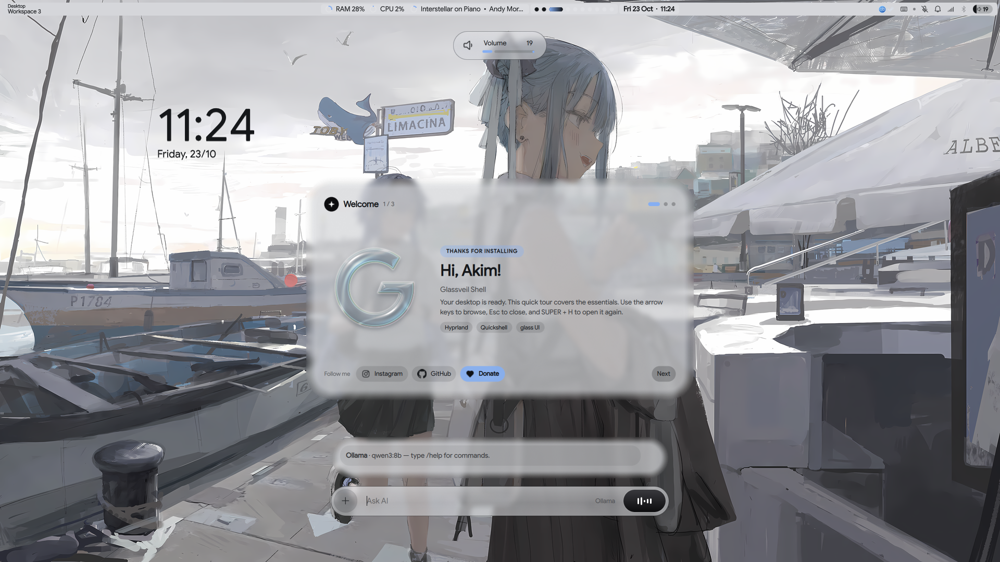

<p align="center">
  
</p>

<p align="center">
  
</p>

<h1 align="center">Glassveil Shell</h1>

<p align="center">
  A minimal Hyprland desktop, built with Quickshell.
</p>

<p align="center">
  <code>Arch Linux</code> · <code>Hyprland</code> · <code>Quickshell</code>
</p>

---

## Contents

- [What is this?](#what-is-this)
- [Features](#features)
- [Requirements](#requirements)
- [Install](#install)
- [Key bindings](#key-bindings)
- [Settings panel](#settings-panel)
- [AI panel](#ai-panel)
- [Theming](#theming)
- [Wallpaper](#wallpaper)
- [Brightness and volume](#brightness-and-volume)
- [Clock and weather](#clock-and-weather)
- [Customization](#customization)
- [Controlling the shell from the terminal](#controlling-the-shell-from-the-terminal)
- [Repository layout](#repository-layout)
- [Troubleshooting](#troubleshooting)
- [Uninstall](#uninstall)
- [License](#license)

## What is this?

A ready-made desktop for Arch Linux.

- **Hyprland** manages your windows.
- **Quickshell** draws the bar, the panels and the menus.

You install it with one command. After that you can change most things from the **Settings panel**. No file editing needed.

## Features

- **Bar, launcher, sidebar, power menu, lock screen** and more. The sidebar holds notifications, Wi-Fi, Bluetooth, a calendar and a pomodoro timer.
- **Settings panel** (`SUPER + B`). Change the look, bar, clock, wallpaper, monitors, notifications, lock screen and night light. Changes apply right away and are remembered.
- **AI panel** (`SUPER + I`). Chat with OpenAI, Claude, Gemini, local Ollama and more. You can attach files and, with Ollama, make pictures.
- **Wallpaper colors.** The accent color comes from your wallpaper. It is used by the shell, kitty, fish, GTK apps, Qt apps and Kvantum. You can also choose light or dark.
- **Image and video wallpapers.**
- **Safe installer.** It backs up your old configs and can restore them.

## Requirements

- Arch Linux or a similar system (CachyOS works)
- Hyprland **0.55 or newer** (the config is written in Lua)
- A normal user account with `sudo`. Do not run the installer as root.

## Install

```bash
git clone https://github.com/akimsupernova/dots
cd dots
./setup install
```

The installer asks before it does anything risky. It does these steps:

1. Offers a full system upgrade (`pacman -Syu`).
2. Installs `yay` if you do not have it, then installs all packages.
3. Offers to turn on the NetworkManager, Bluetooth and LACT services. It can also set up monitor brightness control for external screens.
4. Backs up your old configs, then copies the new ones.
5. Sets the default wallpaper and shows a welcome card at your first login.

After you log in, a welcome card appears. Open it again with `SUPER + H`. Press `SUPER + /` to see all key bindings.

### Installer options

```bash
./setup install             # packages + dotfiles
./setup install --no-deps   # dotfiles only, skip packages
./setup install -n          # dry run: show what would happen, change nothing
./setup install -y          # say yes to everything; does not reboot
./setup install --reboot    # reboot when done, without asking
./setup install --no-reboot # do not ask about rebooting
./setup deps                # install yay and packages only
./setup welcome             # show the welcome card again at next login
./setup uninstall           # remove the dotfiles and restore your backup
./setup help
```

### Important: files are copied, not linked

`./setup install` **copies** the folders into `~/.config`. If you edit files inside the cloned repo, nothing changes until you run `./setup install` again. To try a change on your running system, edit the files in `~/.config` and copy them back to the repo later.

When you run the installer again:

- Your old configs are backed up once, in `~/.local/share/akim-dotfiles-backup/<time>/`.
- `hypr/modules/monitors.lua` and `hypr/custom/keybinds.lua` are **kept**, so your monitors and shortcuts stay.
- On the first install, `hypr/custom/keybinds.lua` is only added if you do not already have one.

### What gets installed where

| Repo folder | Installed to |
| --- | --- |
| `fish`, `gtk-3.0`, `gtk-4.0`, `hypr`, `kitty`, `nwg-look`, `qt5ct`, `qt6ct`, `quickshell` | `~/.config/` |
| `icons` (cursor theme) | `~/.icons/` |
| `fonts` (Google Sans) | `~/.local/share/fonts/` |

The installer keeps its notes (what it installed, where the backup is, the last log) in `~/.local/state/glassveil-shell/`.

### Packages

The full list is the `PACKAGES` array at the top of [`setup`](setup). In short:

| Group | Packages |
| --- | --- |
| Desktop | `hyprland`, `quickshell`, `hyprsunset`, `xdg-desktop-portal-hyprland`, `xdg-desktop-portal-gtk`, `polkit`, `qt6-wayland`, `qt5-wayland` |
| Wallpaper | `awww`, `mpvpaper`, `ffmpeg`, `python-pillow` |
| Theming | `nwg-look`, `qt5ct`, `qt6ct`, `kvantum`, `kvantum-qt5`, `breeze-icons`, `adwaita-icon-theme`, `bibata-cursor-theme-bin`, `dconf`, `gsettings-desktop-schemas` |
| Fonts | `ttf-jetbrains-mono-nerd`, `noto-fonts`, `noto-fonts-cjk`, `noto-fonts-emoji`, `noto-fonts-extra`, `adwaita-fonts` |
| Audio | `pipewire`, `pipewire-pulse`, `pipewire-alsa`, `wireplumber`, `alsa-utils`, `pavucontrol`, `cava`, `playerctl`, `sof-firmware` |
| Network and devices | `networkmanager`, `bluez`, `bluez-utils`, `upower`, `brightnessctl`, `ddcutil` |
| Tools | `kitty`, `fish`, `btop`, `nvtop`, `lact`, `grim`, `slurp`, `wl-clipboard`, `libnotify`, `curl`, `python`, `xdg-utils`, `zenity` (file chooser), `poppler` (reads PDF files) |
| Apps | `zen-browser-bin`, `dolphin`, `kate`, `konsole`, `ark`, `obs-studio` |

## Key bindings

`SUPER` is the Windows key. Press `SUPER + /` to see a live list of every key binding.

### Shell

| Keys | Action |
| --- | --- |
| `SUPER` (tap) | App launcher |
| `SUPER + A` | AI panel |
| `SUPER + N` | Sidebar (notifications, quick toggles, pomodoro) |
| `SUPER + B` | Settings panel |
| `SUPER + R` | Wallpapers |
| `SUPER + SHIFT + R` | Random wallpaper |
| `SUPER + M` | Monitor settings |
| `SUPER + .` | Emojis (click one to copy it) |
| `SUPER + G` | Name card |
| `SUPER + H` | Welcome card |
| `SUPER + /` | Key binding list |
| `SUPER + L` | Lock the screen |
| `SUPER + SHIFT + P` | Power menu |

### Apps

| Keys | Action |
| --- | --- |
| `SUPER + Return` | Terminal (kitty) |
| `SUPER + W` | Browser (zen-browser) |
| `SUPER + E` | File manager (dolphin) |
| `SUPER + C` | Text editor (kate) |
| `SUPER + X` | Steam (not installed by default, see below) |
| `SUPER + O` | OBS Studio |
| `SUPER + I` | Volume control (pavucontrol) |
| `CTRL + SHIFT + ESC` | Task manager (btop in kitty) |

`hypr/custom/keybinds.lua` is **yours**. It holds the author's personal shortcuts (Firefox, Konsole, DaVinci Resolve). Those apps are not installed by the installer. Edit the file by hand to change, remove or add shortcuts.

**Install Steam** (optional):

1. Enable the `[multilib]` section in `/etc/pacman.conf` (remove the `#` from `[multilib]` and the `Include` line below it).
2. Run `sudo pacman -Syu steam`.

### Windows and workspaces

| Keys | Action |
| --- | --- |
| `SUPER + Q` | Close window |
| `SUPER + F` | Fullscreen on or off |
| `SUPER + V` | Floating on or off |
| `SUPER + P` | Pseudo-tile |
| `SUPER + J` | Change split direction |
| `SUPER + arrows` | Move focus |
| `SUPER + 1…0` | Go to workspace 1 to 10 |
| `SUPER + ALT + 1…0` | Move window to workspace 1 to 10 |
| `SUPER + S` | Show or hide the scratchpad |
| `SUPER + SHIFT + S` | Move window to the scratchpad |
| `SUPER + left mouse drag` | Move window |
| `SUPER + right mouse drag` | Resize window |

### Screenshots

| Keys | Action |
| --- | --- |
| `SUPER + SPACE` | Select an area and copy it to the clipboard |
| `ALT + SPACE` | Full screenshot, saved to `~/Pictures/Screenshots` and copied |

### Media

| Keys | Action |
| --- | --- |
| `XF86AudioRaiseVolume` / `XF86AudioLowerVolume` | Volume up / down (2% steps) |
| `XF86MonBrightnessUp` / `XF86MonBrightnessDown` | Brightness up / down |
| `SUPER + mouse wheel` | Volume (scroll up = louder) |
| `SUPER + SHIFT + mouse wheel` | Brightness (scroll up = brighter) |

## Settings panel

Open it with `SUPER + B`, or click the gear at the top of the sidebar (`SUPER + N`).

Every change applies at once and is saved in `~/.config/glassveil/settings.json`. To undo everything, press **Reset** in the About tab.

| Tab | What you can change |
| --- | --- |
| Appearance | **Glassveil style** (Auto, Light or Dark), accent color, interface size, bar height, spacing, corner roundness, font size. Also the gap between windows, the gap to the screen edge and the corner roundness of windows. |
| Bar | Which items show in the bar: window title, system use, media, workspaces, clock, tray, status icons, battery, volume, weather |
| Clock & weather | Clock style and size, 24-hour time, date, weather |
| Wallpaper | Random wallpaper, all your wallpapers, and the **monitor settings** |
| Notifications | Do not disturb, how long pop-ups stay, how many show at once, keep urgent ones until you close them, clear all, test buttons |
| Lock screen & night light | Auto-lock, lock time, screen off after lock, a **Lock now** button, and night light |
| About | System info, links and the Reset button |

### Glassveil style

This setting changes the shell **and** your apps (kitty, fish, GTK apps, Qt apps).

- **Auto** follows your wallpaper. Light wallpaper gives a light theme.
- **Light** or **Dark** stays fixed, whatever the wallpaper looks like.

Apps that are already open may need a restart to show the new colors.

### Window gaps and corners

The three sliders under **App windows** change Hyprland itself. Until you move one, your Hyprland config is not touched. The sliders are applied again after each login and each Hyprland reload. Press **Use config** to go back to the values in your config files.

### Monitor settings

At the end of the Wallpaper tab. Click a monitor on the map to select it. Drag it to move it. You can set the resolution, refresh rate, rotation, scale and position.

After you press **Apply**, you have 10 seconds to press **Keep**. If you do nothing, the old settings come back. This protects you from a black screen. Saved settings go to `~/.config/hypr/modules/monitors.lua`.

The same settings are also on `SUPER + M`.

### Night light

Makes the screen warmer, so it is easier on the eyes at night. Pick a warmth level and, if you like, a schedule. It needs `hyprsunset` (the installer adds it). When you change the warmth, the screen can flicker for a moment.

### Lock screen

- **Lock when idle** has three choices: *Battery only* (laptops lock, desktops do not), *Always* or *Never*.
- Pick how many minutes of no use before the lock.
- **Keep awake** in the sidebar pauses auto-lock.
- `SUPER + L` always locks right away.

## AI panel

Press `SUPER + I`. A box appears at the bottom of the screen. Type your question and press Enter.

Works with **OpenAI, Claude, Gemini, OpenRouter, Groq, DeepSeek, Mistral, xAI** and **Ollama** (runs on your own computer, no key needed).

### Getting started

1. Press `SUPER + I`.
2. Type `/apikey openai sk-...` (or `claude`, `gemini`, ...) and press Enter.
3. Ask something.

For Ollama, install it first, pull a model (for example `ollama pull llama3.2`), then type `/provider ollama`.

### Commands

| Command | What it does |
| --- | --- |
| `/apikey` | Show saved keys (hidden except the ends) |
| `/apikey <provider> <key>` | Save a key and switch to that provider |
| `/apikey remove <provider>` | Delete a saved key |
| `/provider <name>` | Switch provider (or click the provider name in the input bar) |
| `/model <name>` | Change the model (`/model default` resets it) |
| `/endpoint <provider> <url>` | Use another address (OpenAI-compatible, or your Ollama server) |
| `/attach <path>` | Attach a file (see [Attach files](#attach-files)) |
| `/detach` | Remove all attached files |
| `/image <text>` | Make a picture with an Ollama image model (see [Make pictures](#make-pictures)) |
| `/imagemodel <name>` | Choose the model for `/image` (`/imagemodel default` clears it) |
| `/web on\|off` | Let the AI search the internet (see [Web search](#web-search)) |
| `/web backend <name>` | Choose the search service: `ddg`, `searxng` or `ollama` |
| `/web url <url>` / `/web key <key>` | Set the SearXNG address or the Ollama search key |
| `/ctx <tokens>` | Ollama memory size per chat (default 16384) |
| `/clear` | Start a new chat |
| `/help` | Show the commands |

Short names: `chatgpt` = openai, `claude` = anthropic, `google` = gemini, `grok` = xai, `local` = ollama.

The **+** button opens a menu with the same actions: new chat, copy the last reply, provider, web search, attach file, generate image (Ollama only), model, API key and help.

### Attach files

There are three ways:

- Choose **Attach file…** in the **+** menu.
- Drag a file from your file manager onto the panel.
- Type `/attach ~/notes.txt`.

The file shows as a small tag above the input bar. Click the **x** to remove it. It is sent with your next message. If you type nothing, the AI describes or summarizes the file.

| File | What happens | Works with |
| --- | --- | --- |
| Text, code, logs, Markdown, JSON, CSV | The text is added to your message (very long files are cut) | All providers |
| PDF | The text is read out and added to your message | All providers |
| Images (PNG, JPEG, and WebP, GIF, BMP with `python-pillow`) | The image is sent to the model | Ollama models that can see images |

Good to know:

- The model must be able to see images. Try `qwen3.5`, `gemma3`, `llama3.2-vision` or `qwen2.5vl`. If it cannot, the panel tells you and does not send the image.
- The **Attach file…** button opens a file chooser (`zenity`, which the installer adds). The AI panel closes while you choose, then opens again with your file. 
- PDFs need `poppler` (the installer adds it). A scanned PDF has no text to read.
- Attached text stays in the chat, so you can ask more questions about it later.

### Make pictures

Ollama can run image models. This feature is new, and it is still experimental in Ollama.

```text
ollama pull x/z-image-turbo
/imagemodel x/z-image-turbo
/image a lighthouse in a storm, oil painting
```

- If the model you chat with is itself an image model, every message you send makes a picture. You do not need `/imagemodel` then.
- The picture shows in the chat. Click it to open it. A copy is saved in `~/Pictures/Glassveil/`.
- The first picture can take a while, because the model has to load.
- Models that only read images, like Qwen 3.5, cannot draw. Use a separate image model for `/image`.

### Copy and save code

When the AI answers with code or a file (for example an edited SVG), it shows the code in a box with two buttons:

- **Copy** puts the code in your clipboard.
- **Save** writes it to your Downloads folder and shows the path in the chat. Click **Open folder** to see it.

If you attached a file, the saved copy keeps its name and adds `-edited` (for example `arch-edited.svg`). Nothing is ever overwritten. Long code is folded to a few lines in the chat. Click **Show all** to open it. **Copy** and **Save** always use the whole code.

The AI cannot make real files or download links. If it shows a path like `/path/to/file.svg`, that path is made up. Use **Save** instead.

### Web search

Turn it on with **Web search** in the **+** menu, or type `/web on`.

- **Ollama:** the model decides when to search or open a page. It needs a model that supports tools. If it does not, it answers without searching and shows a small note.
- **Other providers:** every message is searched first. The top results are added to your question, and the sources show under the reply.

Search services:

```text
/web backend ddg                no key; reads DuckDuckGo (default)
/web backend searxng            your own SearXNG server
/web url https://search.example.org
/web backend ollama             Ollama web search (free account key)
/web key <key>                  key from https://ollama.com/settings/keys
```

Good to know:

- `ddg` reads a DuckDuckGo page, so it can be slow or stop working. `searxng` and `ollama` are more stable.
- Your searches leave your computer, even when the model runs locally.
- Pages on your own computer or network (localhost, `192.168.x.x`, `10.x.x.x` and similar) are blocked, so a web page cannot trick the model into reaching them.

<details>
<summary><b>Set up SearXNG (optional, for advanced users)</b></summary>

[SearXNG](https://docs.searxng.org/) is a search service you run yourself. It needs Docker (`sudo pacman -S docker && sudo systemctl enable --now docker`) or Podman (use `podman` instead of `docker` below).

```bash
mkdir -p ~/.config/searxng
cat > ~/.config/searxng/settings.yml <<EOF
use_default_settings: true
server:
  secret_key: "$(openssl rand -hex 32)"
  limiter: false
search:
  formats:
    - html
    - json
EOF

docker run -d --name searxng --restart unless-stopped \
  -p 127.0.0.1:8888:8080 \
  -v ~/.config/searxng:/etc/searxng \
  docker.io/searxng/searxng:latest
```

Check that it works. A `403` means `json` is missing from `formats`.

```bash
curl "http://127.0.0.1:8888/search?q=test&format=json" | head -c 300
```

Then, in the AI panel:

```text
/web url http://127.0.0.1:8888
/web backend searxng
/web on
```

Notes:

- `-p 127.0.0.1:8888:8080` keeps it private to your computer. Do not open it to the network.
- Some engines (Google in particular) are sometimes blocked for a while. Results still come from the others.
- To update: `docker pull docker.io/searxng/searxng:latest`, then remove and run the container again.

</details>

### Privacy

- Keys are saved as plain text in `~/.config/glassveil/ai.json`. Only you can read it. The file is outside this repo. **Never commit it.**
- Lines that start with `/` (including your key) are never sent to a provider and never kept in the chat.
- The provider gets only: your last 20 messages, any files you attach, a short system note with today's date, and web results if search is on. The AI cannot see your screen, clipboard or other files, and it cannot run commands.
- The chat is kept in memory only. It is gone when the shell restarts.
- To keep everything on your computer, use `/provider ollama`. With web search on, your searches still go to the internet.

### Notes

- Model names change over time. If you see "model not found", set a new one with `/model <name>`.
- Replies show when they are complete (no live typing yet).
- Screenshots are not attached by the panel. Save the screenshot, then attach the file.
- Web search needs `curl` (the installer adds it).

## Theming

The whole desktop follows the **accent color of your wallpaper**.

```text
wallpaper changed
  └─ apply-wallpaper.sh
       └─ extract_accent.py      saves the color to ~/.local/state/quickshell/accent.json
            └─ theme_sync.py     updates the apps below
```

| App | What is updated |
| --- | --- |
| Quickshell | Reads the color live |
| kitty | `~/.config/kitty/current-theme.conf` |
| fish | Prompt colors, so open terminals update at once |
| GTK 3 / 4 | `gtk.css` colors and the light/dark choice |
| Qt 5 / 6 | A `glassveil` color scheme for `qt5ct` and `qt6ct` |
| Kvantum | A `Glassveil` theme made from an installed Kvantum theme |

These files are rewritten at every change, so do not edit them by hand.

### Light and dark

Pick **Glassveil style** in Settings → Appearance: `Auto`, `Light` or `Dark`. The shell and all apps use the same choice.

`GLASSVEIL_THEME_MODE` (in `hypr/modules/env.lua`) is only a backup. It is used when `~/.config/glassveil/settings.json` does not exist yet.

### Run the sync by hand

```bash
python ~/.config/quickshell/scripts/theme_sync.py                       # use your Settings and the last wallpaper color
python ~/.config/quickshell/scripts/theme_sync.py --style dark          # force auto, light or dark this time
python ~/.config/quickshell/scripts/theme_sync.py --accent "#33ccff"    # force a color
python ~/.config/quickshell/scripts/theme_sync.py --default             # back to the default color
```

## Wallpaper

- Press `SUPER + R` to open the wallpapers. You can also use the **Wallpaper** tab in Settings.
- Images use `awww`. Videos (`mp4`, `webm`, `mkv`, `mov`, `gif`, ...) use `mpvpaper`.
- Put your wallpapers in `~/Pictures/Wallpapers`. The installer adds a default one.
- The current wallpaper is remembered in `~/.config/wallpaper/current` and comes back at login.
- Logs: `$XDG_RUNTIME_DIR/apply-wallpaper.log` and `restore-wallpaper.log`.

## Brightness and volume

- **Laptop screens** use `brightnessctl`.
- **External monitors** use DDC/CI through `ddcutil`. The installer can set this up for you (it adds you to the `i2c` group). **Log out and in again** (or reboot) after that.
- To force one DDC bus, set `DDC_BUS=<number>` when you run `scripts/brightness.sh`.
- Volume uses `wpctl` (PipeWire). The shell shows a small indicator on screen for volume and brightness.

## Clock and weather

You can set the clock and the weather in **Settings → Clock & weather**.

**Desktop clock.** Drag it with the left mouse button. **Hold the left button and scroll** to make it bigger or smaller. **Right-click it** to switch between the digital style and the round style. The choice is saved in `~/.local/state/quickshell/clock-style.json`.

```bash
qs ipc call clock toggleStyle
qs ipc call clock setStyle ring        # or: digital
qs ipc call clock setZoom 1.4          # 0.5 .. 2.5
qs ipc call clock resetZoom
```

The ring shows how much of the day has passed. To show the battery instead, set `property string ringMode: "battery"` in `quickshell/modules/clock/ClockWidget.qml`. On a PC with no battery it shows the day. The ring size is `ringSize` in the same file.

**Weather.** The temperature and an icon show in the bar (left of the battery) and on the round clock. Click the bar item to refresh. The data comes from [Open-Meteo](https://open-meteo.com). It needs no account or key.

<details>
<summary><b>Weather settings file (optional)</b></summary>

The settings are in `~/.config/glassveil/weather.json`. It is created the first time the shell starts. When you save it, the change applies at once.

```json
{
  "enabled": true,
  "city": "",
  "latitude": null,
  "longitude": null,
  "units": "metric",
  "refreshMinutes": 30
}
```

| Key | Meaning |
| --- | --- |
| `enabled` | `false` hides the weather |
| `city` | For example `"Jakarta"`. Empty means your place is found from your IP address |
| `latitude`, `longitude` | Set both to skip the city lookup |
| `units` | `"metric"` for °C, `"imperial"` for °F |
| `refreshMinutes` | How often to update, from 5 to 1440 |

You can also use the terminal:

```bash
qs ipc call weather setCity "Bandung"
qs ipc call weather setUnits imperial
qs ipc call weather setCoords -6.9 107.6
qs ipc call weather status
qs ipc call weather refresh
qs ipc call weather toggle
```

The shell needs internet for the weather. If a request fails, it keeps the last value and tries again later.

</details>

## Customization

Most things are in the **Settings panel**. For the rest, edit these files:

| I want to... | Edit |
| --- | --- |
| Change the look, bar, clock, notifications, lock screen or night light | The Settings panel (saved in `~/.config/glassveil/settings.json`) |
| Change default apps (terminal, browser, file manager) | `hypr/modules/programs.lua` |
| Add or change key bindings | `hypr/custom/keybinds.lua` (yours, edit by hand) or `hypr/modules/keybinds.lua` |
| Set up monitors | The Settings panel, or `hypr/modules/monitors.lua` (kept when you run the installer again) |
| Change gaps, rounding, blur | `hypr/modules/appearance.lua` (the sliders in Settings win until you press **Use config**) |
| Change animations | `hypr/modules/animations.lua` |
| Change keyboard layout, touchpad | `hypr/modules/input.lua` |
| Run programs at startup | `hypr/modules/autostart.lua` |
| Window rules (blur, floating) | `hypr/modules/rules.lua` |
| Change shell fonts and transparency | `quickshell/common/Theme.qml` |
| Change AI providers or default models | `quickshell/services/Ai.qml` |
| Change the weather place or units | `~/.config/glassveil/weather.json` |
| Change the weather icons | `quickshell/assets/icons/weather-*.svg` |
| Change the terminal font and look | `kitty/kitty.conf` |

Remember: edit files in `~/.config/...` to see changes at once. Or edit the repo and run `./setup install --no-deps`.

A new shell window needs a rule in `rules.lua` to get blur. Its name is set in the QML file with `WlrLayershell.namespace` (for example `"Glassveil Shell AI"`).

## Controlling the shell from the terminal

You can control every part of the shell from a terminal:

```bash
qs ipc show                       # list all targets and functions
qs ipc call launcher toggle
qs ipc call ai toggle
qs ipc call settings toggle
qs ipc call sidebar toggle
qs ipc call wallpaper toggle
qs ipc call lock lock
```

Targets: `ai`, `battery`, `brightness`, `cheatsheet`, `clock`, `emoji`, `launcher`, `lock`, `monitor`, `namecard`, `notifications`, `pomodoro`, `power`, `settings`, `sidebar`, `wallpaper`, `weather`, `welcome`. Run `qs ipc show` to see what each one can do.

## Repository layout

```text
.
├── setup                     installer / uninstaller
├── hypr/
│   ├── hyprland.lua          starting point, loads the modules below
│   ├── modules/              appearance, animations, input, keybinds, rules, ...
│   └── custom/keybinds.lua   your own key bindings
├── quickshell/
│   ├── shell.qml             main file, loads every module
│   ├── common/               shared parts (Theme, Panel, Icon, buttons, settings storage, ...)
│   ├── services/             state and background work (Network, Notifs, Ai, Brightness, ...)
│   ├── modules/              one folder per feature (bar, launcher, sidebar, settings, ai, ...)
│   ├── scripts/              wallpaper, brightness, theme sync, AI file and image helpers
│   └── assets/               icons, wallpaper, emoji list, previews
├── kitty/  fish/  gtk-3.0/  gtk-4.0/  qt5ct/  qt6ct/  nwg-look/
├── icons/                    cursor theme
└── fonts/                    Google Sans
```

## Troubleshooting

**The installer fails.** It shows the failing step, the last lines of output and common fixes. The full log of the last command is in `~/.local/state/glassveil-shell/last-command.log`. Fix the problem and run `./setup install` again. It is safe to repeat. If you installed the packages yourself, use `./setup install --no-deps`.

**Hyprland shows a config error.** Check the version with `Hyprland --version`. It must be 0.55 or newer.

**The shell does not start or looks broken.** Run `quickshell` in a terminal to see the errors. After you edit files, restart it with `pkill quickshell; quickshell &`.

**`qs ipc call ...` does nothing.** Make sure the shell is running. Check the target name with `qs ipc show`.

**Emoji or some fonts do not show.** Run `fc-cache -f`. Make sure `noto-fonts-emoji` and `noto-fonts-cjk` are installed.

**Brightness keys do nothing on an external monitor.** The monitor must support DDC/CI (turn it on in the monitor's own menu). Run `id` to check that you are in the `i2c` group, and log in again after the install.

**Wi-Fi or Bluetooth menus are empty.** They need the `NetworkManager` and `bluetooth` services: `sudo systemctl enable --now NetworkManager bluetooth`.

**The wallpaper or colors do not change.** Read `$XDG_RUNTIME_DIR/apply-wallpaper.log`. Run `theme_sync.py` by hand to see errors.

**Apps do not match the Glassveil style.** Close and open them again. GTK and Qt apps read their colors only when they start. For Qt apps, make sure `kvantum` and `qt5ct` / `qt6ct` are installed.

**Night light does nothing.** It needs `hyprsunset` (`sudo pacman -S hyprsunset`). The Settings panel shows a note when it is missing.

**The window gap sliders do nothing.** They need Hyprland 0.55 or newer. Try `hyprctl eval 'hl.config({ general = { gaps_in = 10 } })'` in a terminal. If that fails too, the problem is in Hyprland, not the shell.

**Attach file… does nothing.** Install a file chooser: `sudo pacman -S zenity`. You can also drag the file onto the panel or use `/attach <path>`.

**The AI cannot see my image.** The model must support images. Try `qwen3.5`, `gemma3` or `llama3.2-vision`. Run `ollama show <model>` and look for `vision` under capabilities.

**The AI shows a strange file path or link.** The AI cannot create files. Use the **Save** button on its code box. If there is no code box, ask it to "reply with the full file in a code block".

**The AI says "model not found".** Set a current model with `/model <name>`. Check your provider's website for model names.

## Uninstall

```bash
./setup uninstall
```

This removes the installed dotfiles and restores your old configs from the backup. Files the installer did not create are left alone.

## License

[GNU General Public License v3.0](LICENSE)
